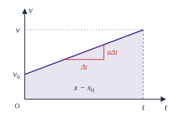

# The Learn guide (교재)

Chapters shown at `#/learn/guide`. Each chapter is two Markdown files, one per language, in the folder of its unit:

```
guide/<area>/<unit>/<chapter>.ko.md
guide/<area>/<unit>/<chapter>.en.md
guide/fig/<name>.svg            figures (SVG or PNG), shared by both languages
```

`<area>/<unit>` is a key of `SUBTOPICS` in `learn-path.js`, for example `mechanics/kinematics` or `em/induction`.
`<chapter>` is lower-case letters, digits and hyphens. It becomes the address: `#/learn/guide/mechanics/kinematics/constant-acceleration`.

## Adding a chapter

1. Write `guide/<area>/<unit>/<chapter>.ko.md` and `.en.md`, starting with the front matter below.
2. Put figures in `guide/fig/`. Symbols only in the drawing (no Korean or English words), so one file serves both languages.
3. Run `node tools/build-guide.cjs`. It checks the chapter and rewrites `guide/index.json` (the list and the search text)
   and the `?v=` digests of `guide.js` and `guide.css` in `index.html`.
4. Run `node --test tests/test-guide.cjs`. `node tools/build-guide.cjs --check` fails if you forgot step 3.

A unit with no chapter shows "준비 중 / Coming soon" with links to its problems and simulation. Do not add a placeholder
chapter: the unit page already says what will be there.

## Front matter

```
---
title_ko: 운동학: 등가속도 운동
title_en: "Kinematics: constant acceleration"
unit: mechanics/kinematics
level: 3
order: 1
summary: One line in this file's language, shown in the unit's list.
---
```

- `title_ko` and `title_en` are the same in both files. Quote a value that contains a colon.
- `unit` must match the folder.
- `level` is the step (1 to 10) of `learn-path.js` that the chapter is written for; the page shows its stage.
- `order` sorts the chapters of one unit.

## Writing

- `## Heading` starts a numbered section and goes into the table of contents. `### Heading` is a subheading.
- Paragraphs, `- ` and `1. ` lists, `**bold**`, `*italic*`, `` `code` ``, `[text](https://…)` or `[text](#/learn/…)`.
- Inline math `$v = v_0 + at$`. Write a literal dollar sign as `\$`.
- Display math is numbered automatically. Give it a label to refer to it:

  ```
  $$ v = v_0 + a t $$ {#v-t}
  ```

  or across lines, with the label after the closing `$$`. Refer to it in the text as `[@v-t]`, which prints `(1)`.
- A figure on a line of its own, numbered automatically; `[@vt-graph]` prints `그림 1` / `Figure 1`:

  ```
  {#vt-graph}
  ```

## Boxes

Open with `:::name` and an optional title, close with `:::` on its own line.

| box | shows |
| --- | --- |
| `:::result` | the key result, boxed |
| `:::remark` | a side note |
| `:::why Title` | an answer to a natural "why?" |
| `:::derivation Title` | a derivation, folded until the reader opens it |
| `:::example Title` | a worked example |
| `:::try Title` | an exercise; put `:::solution` inside it, folded until opened |

```
:::try A train starting from rest
A train covers 100 m in 10 s from rest. Find its acceleration.

:::solution
$100 = \frac12 a (10)^2$, so $a = 2\ \mathrm{m/s^2}$.
:::
:::
```

The Korean and English files must have the same number of equations and exercises, so that equation (3) is the same
equation in both. The build refuses an em dash; use a colon, a comma or a full stop.

## Handouts

PDF handouts are not in this folder. Administrators upload them on the page (`#/learn/guide?tab=handouts`); the server
(`community/src/handouts.js`) keeps them in R2 under `handouts/`.
